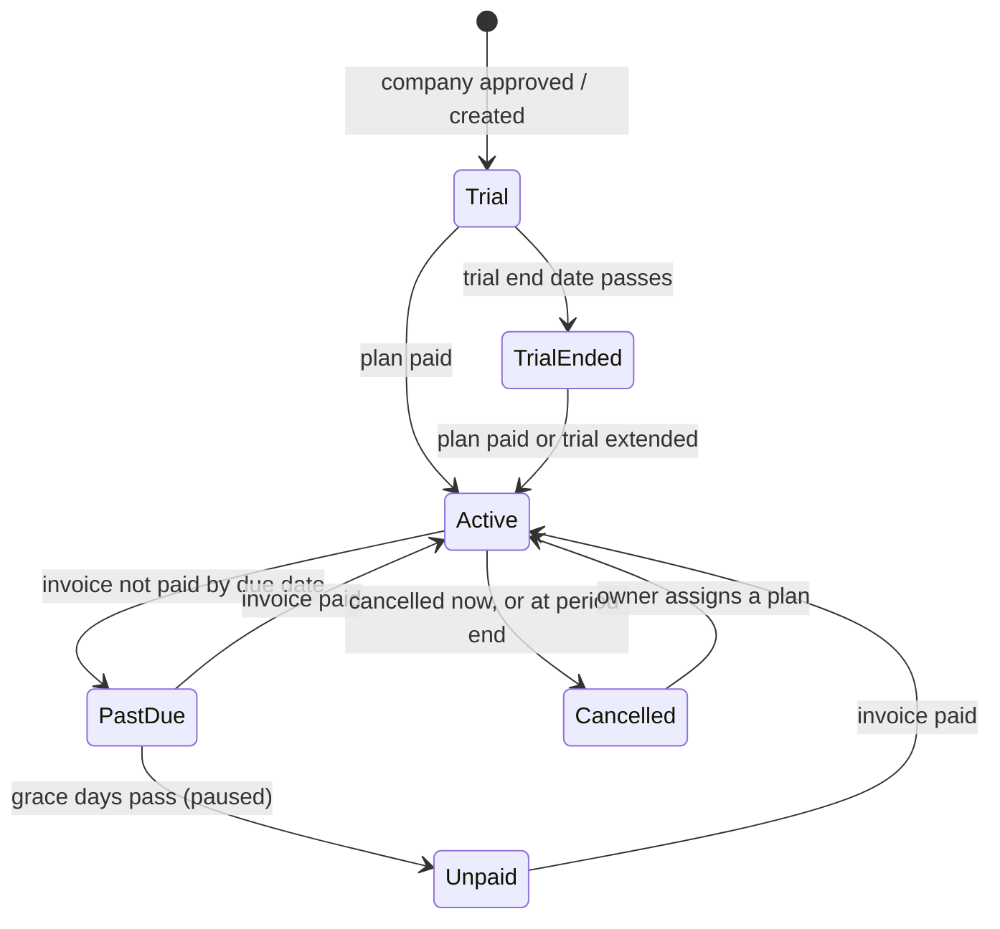

# Samah HRM Billing Manual

Version: 15 November 2026

---

## 1. Introduction

Samah HRM bills every company on the platform through one subscription each. This manual shows how to run that billing from start to finish.

The billing side covers plans, free trials, invoices, payments, refunds and pausing companies that do not pay. Most of it runs on its own: renewals, reminders and overdue checks happen automatically every few minutes.

This manual has two readers:

- **The platform owner (Super admin).** You set up plans and prices, approve new companies, confirm payments and keep an eye on revenue. Chapters 3 to 7 are for you.
- **A company's HR admin.** They see their own plan, pay invoices and choose a new plan. Chapter 8 is for them.

Managers and employees never see billing.

> **Note:** Places marked *[Screenshot: …]* are where a picture of that screen should go.

---

## 2. Key ideas and glossary

Every company has exactly one subscription to one plan, billed monthly or yearly. The subscription's status decides whether the company can work.

### Roles

| Role | What they do in billing |
| --- | --- |
| Super admin (platform owner) | Sees every company. Manages plans, approvals, invoices, payments, refunds and settings. |
| HR admin | Manages one company. Sees its plan, usage and invoices, and pays. |
| Manager, Employee | No access to billing. |

### Subscription statuses

| Status | Shown as | Can the company work? |
| --- | --- | --- |
| Trialing | Trial | Yes, free until the trial end date |
| Active | Active | Yes, paid up |
| Past due | Past due | Yes, but an invoice is overdue |
| Unpaid | Unpaid (blocked) | No, paused after the grace period |
| Expired | Trial ended | No, paused until a plan is chosen |
| Cancelled | Cancelled | No, paused |

When a company is paused, its people can still sign in, but they only see a "paused" message. HR admins can still open the Subscription page to pay. **Data is always kept.**

### Company statuses

These are separate from the subscription:

- **Pending (Awaiting approval):** the company signed itself up and is waiting for you. Nobody in it can sign in.
- **Active:** normal.
- **Suspended:** blocked by you. Every login is refused.

### Invoices and payments

- **Invoice numbers** look like `INV-2026-000042`: the year, then a running number.
- Each invoice has a period, an issue date, a due date, a subtotal, tax and a total.
- **Invoice status:** Open (awaiting payment), Paid, or Void (cancelled). A partly paid invoice stays Open until it is fully paid.
- **Payments can never be edited or deleted.** A refund is a new record against the payment.
- **Currencies are never added together.** Totals in different currencies are shown side by side.
- **Changing plan** starts a new billing period today. Unpaid invoices of the old plan are voided. There is no proration: no partial credit for unused days.

---

## 3. Owner guide: Platform dashboard

The Platform dashboard is your home page. It shows how many companies you have, what they pay and what needs your action today. Every money figure comes from recorded invoices and payments.

Your left menu has five items: **Dashboard, Companies, Plans, Billing, Settings.**

*[Screenshot: Platform dashboard]*

### Action banners

Two yellow banners appear at the top when something is waiting for you:

- **"N payments are waiting for your confirmation":** click *Check and confirm* to go to Billing.
- **"N new companies are waiting for your approval":** click *Review sign-ups* to see them under Companies.

### Count cards

| Card | What it counts |
| --- | --- |
| Companies | All companies, with how many are active, awaiting approval and suspended |
| On trial | Companies on the free trial, plus how many trials have ended |
| Paying subscriptions | Active plus past due, with the past-due count |
| Paused or cancelled | Unpaid plus cancelled |
| Users | All users, with active employees |

### Money cards

Each money card shows one amount per currency.

| Card | Meaning |
| --- | --- |
| Monthly recurring revenue (MRR) | What active and past-due subscriptions bring in per month. A yearly price counts as price ÷ 12. |
| Annual recurring revenue (ARR) | MRR × 12 |
| Collected (all time) | Payments received minus refunds, plus the amount for this month |
| Awaiting payment | Total of open invoices, and how many there are |
| Overdue | Open invoices past their due date |

### Charts and tables

- **Revenue collected by month:** the last 12 months, stacked by currency.
- **New companies by month:** how many companies registered each month.
- **Renewals and trial ends, next 30 days:** company, plan, date and amount. "Cancels then" marks a subscription that ends on that date.
- **Recent payments:** date, company, invoice and amount. Refunds show a minus sign.
- **Recently registered companies:** name, date, plan and status.

### Run billing check now

Billing checks itself every few minutes, but you can run the check at once:

1. Click **Run billing check now** (top right).
2. A message reports how many subscriptions were renewed, made past due or paused, and how many trials ended.

> **Tip:** Running it more than once is safe. It never bills a company twice for the same period.

---

## 4. Owner guide: Companies

The Companies page lists every company on the platform. Each company's own page is where you approve, edit, bill, suspend or delete it.

### The company list

*[Screenshot: Companies, cards view]*

- **Search** by name or slug (the company's short web name, for example `acme`).
- **Cards / Table** switches the view. Your choice is remembered.
- **Status pills** filter the list, each with a count: All, Awaiting approval, On trial, Active, Past due, Unpaid, Trial ended, Cancelled, Suspended. Empty filters are hidden.

Each company shows:

- logo, name, slug and status badges
- plan and price
- next date (renewal or trial end)
- employees against the plan limit, as a bar that turns amber near the limit and red when full
- balance due
- first HR admin and registration date

Pending companies have a **Review** button.

### Add a company yourself

1. Click **New company**.
2. Enter the company name. The slug fills in by itself; change it if you like.
3. Pick the time zone and currency.
4. Optionally add the first HR admin: full name, email and a temporary password (at least 8 characters).
5. Click **Create company**. The company starts on the free trial plan and its page opens.

> **Tip:** Share the temporary password securely. The HR admin can then add the other HR admins.

### The company page

Click any company to open its page.

*[Screenshot: Company page]*

#### Approve or reject a sign-up

These buttons only appear for companies awaiting approval.

1. Check the contact details in the yellow banner.
2. To approve, click **Approve**, then confirm. The free trial starts today and the company is emailed.
3. To reject, click **Reject**, type a reason and confirm instead. The reason stays in your audit log and is not sent. The company gets a short "not approved" email and stays blocked. You can still reactivate it later.

#### Edit company details

1. Click **Edit company**.
2. Change any of: name, slug, contact email, phone, country, address, time zone, currency.
3. Click **Save changes**.

> **Note:** The currency cannot change after the company's first payroll run, because salaries and payslips are in that currency.

#### Edit an HR admin's login

1. In the **Usage** card, find the HR admin and click **Edit**.
2. Change the full name, the sign-in email, or type a new password (at least 8 characters). Leave the password empty to keep the current one.
3. Click **Save**.

> **Note:** A new password signs that person out on every device.

#### Suspend or reactivate

- **Suspend company:** type a reason and confirm. Every user is signed out and cannot sign in. The data is kept.
- **Reactivate company:** add an optional note and confirm.

#### Delete a company

1. Click **Delete company**.
2. Read the warning, then type the company's name exactly.
3. Click **Delete permanently**.

> **Warning:** This cannot be undone. It deletes everything in the company: employees, logins, attendance, leave, payroll, payslips, tasks, files, invoices and payments. Only the record that you deleted it stays in your audit log. To block access but keep the data, suspend the company instead.

#### Manage the subscription

The **Subscription** card shows the plan and price, dates, limits and modules, with these buttons:

| Button | What it does |
| --- | --- |
| Change plan | Pick an active plan and Monthly or Yearly. A paid plan starts a new period today and issues an invoice now; unpaid old invoices are voided. Only plans the company's current usage fits into can be chosen. |
| Custom limits | Set this company's own maximum active employees and HR admin logins, for example for a negotiated deal. Empty = unlimited. Resets when the plan changes. |
| Extend trial | Pick a new trial end date. Also reopens a trial that has ended. Shown on Trial or Trial ended. |
| Cancel subscription | Either at the end of the paid period (access continues until then, no more billing) or right now (access stops). The reason is optional. Assigning a plan later reactivates the company. |
| Withdraw cancellation | Undoes a cancellation planned for the end of the period. |

#### Other cards on the page

- **Usage:** active employees and HR admin logins against limits, total employee records and active offices.
- **Invoices:** with *Record payment* and *Void* (see chapter 6).
- **Payments this company reported:** payment reports waiting for you, with a link to Billing.
- **Payments:** with *Refund*.
- **Subscription history:** every event with its time, status change, details and who did it (or "System").

---

## 5. Owner guide: Plans

Plans are what companies can buy. Each plan sets a price, limits and the modules included. Seven plans come ready to use, and you can change, add, archive or delete them.

*[Screenshot: Plans page]*

### Reading the plan cards

- Switch between **Monthly prices** and **Yearly prices** at the top. Yearly cards show "Save X% vs monthly".
- Each card shows the plan's picture, name, code, status, description, price, employee limit, HR admin limit, each module ticked or crossed, and how many companies use it.
- The paid plan with the most companies gets a **Most popular** ribbon.
- Turn on **Show archived** to see archived plans.

### Create or edit a plan

1. Click **New plan**, or **Edit** on a card.
2. Fill in the fields (see the table below).
3. Choose the modules: either keep **All modules (including ones added later)** on, or switch it off and pick them one by one.
4. Click **Create plan** or **Save plan**.

| Field | Notes |
| --- | --- |
| Name | Shown to companies |
| Code | Lowercase letters, numbers, dashes. Cannot change later. |
| Price currency | Currency of the prices |
| Status | Active (can be assigned), Inactive (hidden from new assignments), Archived |
| Monthly price, Yearly price | 0 = free |
| Trial days | Used when the plan is free (for example the free trial) |
| Display order | Lower numbers show first |
| Max active employees, Max HR admin logins | Empty = unlimited |
| Description | One line shown on the card |

The modules are: Attendance, Work from home, Leave, Payroll, Overtime, Loans & advances, Auto check-in, Selfie verification, Daily tasks.

> **Note:** Price and limit changes apply only when the plan is next assigned. Companies already on the plan keep their price and limits.

### Delete or archive

- **Delete** only works for a plan no company has ever used, and never for the plan new companies start on.
- Otherwise set the plan's status to **Archived**. Companies already on it keep it, but nobody new can get it.

### Plans included out of the box

Prices are in PKR. You can change all of them.

| Plan | Monthly | Yearly | Employees | HR admins | Modules |
| --- | --- | --- | --- | --- | --- |
| Free trial | Free, 14 days | – | 25 | 3 | All |
| Basic | 2,499 | 24,990 | 10 | 1 | Attendance, Leave |
| Starter | 4,999 | 49,990 | 25 | 2 | Attendance, WFH, Leave |
| Growth | 7,499 | 74,990 | 50 | 3 | Attendance, WFH, Leave, Payroll |
| Professional | 9,999 | 99,990 | 100 | 5 | Attendance, WFH, Leave, Payroll, Overtime, Loans, Auto check-in |
| Business | 17,999 | 179,990 | 250 | 10 | All |
| Enterprise | 24,999 | 249,990 | Unlimited | Unlimited | All |

---

## 6. Owner guide: Billing

The Billing page holds every company's invoices and payments, in three tabs: **To verify**, **Invoices** and **Payments & refunds**. Invoices are issued automatically; you record money here as it arrives.

*[Screenshot: Billing, To verify tab]*

### To verify: payments companies reported

When a company pays by bank transfer, JazzCash, EasyPaisa, cheque or cash, its HR admin reports the payment, optionally with a receipt. The tab label shows how many reports are waiting, for example *To verify (2)*.

To confirm a payment:

1. Open the receipt and check that the money is in your bank account.
2. Click **Confirm**, then **Yes, money received**.
3. The payment is recorded on the invoice. For a plan purchase, the new plan starts today. If less than the full amount was paid, the rest stays due.

To reject a payment:

1. Click **Reject**.
2. Type a reason the company will see, for example "No transfer with this reference reached our account".
3. Click **Reject payment**. The company is told and can send the report again.

> **Warning:** Only confirm once the money is actually in your account.

### Invoices

Use **Show** to filter: Open (awaiting payment), Paid, Void, or All.

**To record a payment** received outside the app:

1. Click **Record payment** on the invoice.
2. Enter the amount (up to the amount due), the method (Bank transfer, Cash, Cheque, Card, Online, Other), a reference, the date received (today or earlier) and an optional note.
3. Save. When the invoice is fully paid it becomes **Paid**, and a past-due or unpaid company becomes **Active** again.

**To void (cancel) an invoice:**

1. Click **Void**.
2. Type a reason and confirm.

> **Note:** Only an open invoice with no payments can be voided. Refund its payments first.

### Payments & refunds

This tab lists every payment and refund. To record money you have returned to a company:

1. Click **Refund** on the payment.
2. Enter the amount (up to what has not been refunded yet) and a reason.
3. Click **Record refund**. The invoice becomes payable again for the refunded amount.

> **Note:** The refund itself happens outside the app, by bank or cash. The app only records it.

---

## 7. Owner guide: Platform settings and audit log

Platform settings decide how companies join, pay and are reminded. The audit log records everything you and the system have done. Open **Settings** in the left menu; it has two tabs, **Rules** and **Audit log**.

*[Screenshot: Platform settings, Rules tab]*

### Rules

Change any setting, then click **Save changes** in the bar that appears at the bottom. **Discard** undoes your unsaved changes.

**Joining & signing in**

- **Companies can sign up themselves:** shows "Create a company account" on the sign-in page.
- **I approve new companies first:** a new company cannot sign in until you approve it under Companies. On by default. Turning it off asks you to confirm.
- **Email a code at sign-in (OTP):** after the password, everyone (you too) enters a 6-digit code sent to their email. This needs working email. Make sure your own login email is a real inbox before turning it on.

**Free trial**

- **Plan for new companies:** the plan every new company starts on (default: Free trial).
- **Remind them this many days before the trial ends:** default 3.

**Invoices & tax**

- **Days to pay an invoice:** default 7.
- **Grace days after the due date:** default 7. After the grace days, the company is paused.
- **Tax rate (%):** default 0. Applied to new invoices.
- **Tax name on invoices:** default "Sales tax".

> **Example:** An invoice due on day 7 with 7 grace days is past due from day 8 (the company still works) and paused from day 15.

**Getting paid**

- **Support / billing email:** shown to companies so they can reach you.
- **Payment instructions:** for example your bank account title, IBAN, and "use the invoice number as the payment reference". Companies see these on their Subscription page.

### Audit log

The audit log is a timeline grouped by day, newest first. Each entry shows the action, the time, the company (or "Platform"), who did it (or "System") and the reason when one was given.

Colours help you scan it:

- **red:** rejections, suspensions, deletions, voids, cancellations
- **green:** approvals, reactivations, payments recorded
- **blue:** plan changes
- **gold:** other billing and subscription events

---

## 8. Company guide (HR admins): Subscription

The **Subscription** page is where a company's HR admin sees the plan, pays invoices and chooses a new plan. Only HR admins can see it.

*[Screenshot: Subscription page]*

### Banners at the top

- **"Your free trial has ended":** the system is paused for everyone until a plan is chosen. Data is kept.
- **"Access is paused":** an invoice is unpaid. Access returns as soon as it is paid.
- **"Your subscription was cancelled":** choose a plan to reactivate it.
- **"Invoice X is overdue":** shows the amount and due date. Pay soon to avoid a pause.
- After a card payment: **"Thank you, your payment went through"**, or **"Payment cancelled; nothing was charged"**.

### Current plan and usage

- **Current plan:** plan name, price, dates and included modules.
- **Usage:** active employees and HR admin logins against the plan's limits.

### Paying an invoice by bank transfer or other methods

1. Read the **How to pay** card for the bank details.
2. Make the payment, using the **invoice number as the payment reference**.
3. In **Invoices**, click **I've paid** on that invoice.
4. Fill in the amount, how you paid (Bank transfer; JazzCash / EasyPaisa / online; Cheque; Cash; Other), the reference, the date and an optional note.
5. Attach the receipt if you have one: a photo (PNG or JPEG) or a PDF, up to 2 MB.
6. Send. The invoice shows **Payment sent** until the platform confirms it, usually within one working day. You get a notification and an email either way.

### Paying by card

**Pay by card** appears only when online payment is switched on.

1. Click **Pay by card** on the invoice and confirm.
2. You are taken to Stripe's secure payment page. Your card number never reaches Samah HRM.
3. After paying you return to the Subscription page. The payment appears within a few seconds.

### Choosing or changing a plan

1. In the **Plans** table, pick **Monthly** or **Yearly**.
2. Compare the price, employee and HR admin limits, and modules.
3. Click **Choose · price** on the plan you want.
4. Pay by card, or pay using the payment details and report it with **I've paid**.
5. The plan starts as soon as the payment is confirmed, for a full month or year from that day. Tax is added if the platform charges it.

### Plan limits

- Adding an employee or HR admin beyond the plan's limit is refused with a message such as *"Your Starter plan allows up to 25 active employees, and all are in use. Upgrade the plan or deactivate one first."*
- Modules not included in your plan are not available to your company.

---

## 9. Automatic billing

Billing runs by itself every 5 minutes (changeable with the server setting `JOBS_INTERVAL_S`). It also runs whenever the owner clicks **Run billing check now**. Running it twice never bills twice.

### How a subscription moves between statuses

(If your viewer does not draw the diagram, read it as the list below.)

### What happens automatically

| When | What the system does |
| --- | --- |
| N days before the trial ends (default 3) | Sends a trial reminder, once |
| The trial end date passes | Status becomes Trial ended and the company is paused. Access stops on the exact day, even before the check runs. |
| A paid period ends | A new period starts and one invoice is issued (price + tax), due after "Days to pay". If the server was off, each missed period gets its own invoice. |
| A period ends with "cancel at period end" set | Status becomes Cancelled |
| The due date passes, invoice still open | Active becomes Past due. The company still works. |
| The grace days pass, invoice still open | Status becomes Unpaid and the company is paused |
| Nothing overdue is left | Status returns to Active. If the company was paused past its period end, a fresh period starts today, with no charge for the paused time. |

### Worked example

Default settings: 14-day trial, 7 days to pay, 7 grace days.

1. **1 March:** Acme signs up and confirms its email. It shows as *Awaiting approval*.
2. **1 March:** you approve Acme. Its 14-day free trial starts.
3. **12 March:** Acme's HR admins get a "trial ending soon" reminder.
4. **16 March:** the trial has ended. Acme is paused and sees "Your free trial has ended".
5. **16 March:** the HR admin chooses Professional (monthly), pays by bank transfer and clicks **I've paid** with the receipt.
6. **16 March:** you confirm it in Billing > To verify. The plan starts today and invoice INV-2026-000001 is marked Paid.
7. **16 April:** the next month's invoice is issued, due on 23 April.
8. **24 April:** it is still unpaid, so Acme is *Past due* but still working.
9. **1 May:** the grace days are over. Acme is *Unpaid* and paused.
10. **2 May:** the payment arrives and you record it. Acme is *Active* again.

---

## 10. Emails and notifications

Billing sends both an in-app notification and an email to the company's HR admins at each step below. Email must be set up for emails to go out (see chapter 13).

| Event | Who is told |
| --- | --- |
| Trial ending soon | Company HR admins |
| Trial ended (paused) | Company HR admins |
| Invoice issued | Company HR admins |
| Invoice overdue | Company HR admins |
| Access paused (unpaid) | Company HR admins |
| Payment received | Company HR admins |
| Payment report confirmed or rejected (with the reason) | Company HR admins |
| Company approved, or not approved | The company's contact email and HR admins |
| A company reports a payment | Owner's support email |
| A new company signs up and waits for approval | Owner's support email |

### How company sign-up works

1. The company fills in the sign-up form on the sign-in page.
2. They receive a one-time email link, valid for 24 hours. Nothing is created until the link is opened.
3. Opening the link creates the company on the trial plan with its first HR admin.
4. If approval is required, the company waits as *Awaiting approval* until you approve it.

---

## 11. Settings reference

| Setting | Default | Where |
| --- | --- | --- |
| Companies can sign up themselves | On | Settings > Rules > Joining & signing in |
| I approve new companies first | On | Settings > Rules > Joining & signing in |
| Email a code at sign-in (OTP) | On | Settings > Rules > Joining & signing in |
| Plan for new companies | Free trial | Settings > Rules > Free trial |
| Trial reminder (days before end) | 3 | Settings > Rules > Free trial |
| Days to pay an invoice | 7 | Settings > Rules > Invoices & tax |
| Grace days after the due date | 7 | Settings > Rules > Invoices & tax |
| Tax rate (%) | 0 | Settings > Rules > Invoices & tax |
| Tax name on invoices | Sales tax | Settings > Rules > Invoices & tax |
| Support / billing email | Empty | Settings > Rules > Getting paid |
| Payment instructions | Empty | Settings > Rules > Getting paid |
| Billing check interval | 5 minutes | Server setting `JOBS_INTERVAL_S` (seconds) |
| Card payments | Off | Server settings `STRIPE_SECRET_KEY` and `STRIPE_WEBHOOK_SECRET` |

---

## 12. Troubleshooting and FAQ

**A company says it is paused. What do I check?**
Open Companies, then the company. Look at its subscription status, its open invoices and its trial end date. Pay, record a payment, extend the trial or change the plan as needed.

**I confirmed a payment, but the company is still paused.**
Another overdue invoice may still be open. Check the company's Invoices card. The company returns to Active only when nothing overdue is left.

**I can't delete a plan.**
A company has used it, or it is the plan new companies start on. Archive it instead.

**I can't void an invoice.**
It has payments. Refund them first, then void it.

**There is no "Pay by card" button.**
Online payment is not set up (the Stripe keys are missing). Companies pay by bank transfer and click **I've paid**.

**Emails are not arriving.**
Email must be set up through Resend (API key) or Gmail SMTP. The sign-in code (OTP) also depends on email. If you are locked out because email broke, the server setting `LOGIN_OTP=off` turns the code off.

**The sign-in page shows "Request failed (502)".**
The API server is not running. Start it with `npm run dev` in the project folder.

**Can I give one company more employees than its plan allows?**
Yes. On the company page, use **Custom limits**. They reset if you change the company's plan.

**What happens to a company's data when it is paused, cancelled or suspended?**
It is kept. Only **Delete company** removes data, and that cannot be undone.

---

## 13. Tools and technology

| Area | Technology | Used for |
| --- | --- | --- |
| Web app | React 19, Vite 8 | The screens in the browser (single-page app) |
| Styling | Plain CSS, light and dark themes | Look and feel |
| Maps | Leaflet | Office locations (geofences) for attendance |
| Server | Node.js 24, Fastify 5 | The API under `/api` |
| Sign-in | JWT sessions, bcrypt password hashing, emailed 6-digit code (OTP) | Secure sign-in |
| Database | PostgreSQL in production, or PGlite (embedded Postgres, no install) locally | All data; payments, audit log and billing history can never be edited |
| Optional cloud | Firebase Authentication and Realtime Database (firebase-admin, Firebase Web SDK) | Firebase sign-in and data sync, when switched on |
| Card payments | Stripe Checkout (hosted card page, signed webhooks) | Paying invoices and plans by card |
| Manual payments | Built in | Bank transfer, JazzCash, EasyPaisa, cheque, cash, with receipt upload |
| Email | Resend API, or SMTP through Nodemailer (e.g. Gmail) | Notifications, sign-up links, sign-in codes |
| PDF | PDFKit | Payslips |
| Background jobs | Built-in scheduler in the server | Billing, reminders, queued emails |
| Quality | Node's built-in test runner (226 automated tests), oxlint | Checking that features keep working |
| Sharing | Cloudflare tunnel; `APP_URL` sets the address in email links | Opening the app from other devices |

### Useful commands (run in the project folder)

| Command | What it does |
| --- | --- |
| `npm run dev` | Starts the server and the web app |
| `npm run seed` | Loads demo data |
| `npm run create-owner` | Creates the first super admin on a fresh database |
| `npm run reset-password -- email "new password"` | Resets a login's password (stop `npm run dev` first) |
| `npm test` | Runs the automated tests |

---

## 14. Cheat sheet

| I want to… | Where to click |
| --- | --- |
| See revenue and what needs attention | Dashboard |
| Run billing immediately | Dashboard > Run billing check now |
| Approve or reject a new company | Companies > Awaiting approval > company > Approve / Reject |
| Add a company myself | Companies > New company |
| Edit a company's details | Companies > company > Edit company |
| Change an HR admin's name, email or password | Companies > company > Usage > Edit |
| Change a company's plan | Companies > company > Change plan |
| Give a company custom limits | Companies > company > Custom limits |
| Extend a trial | Companies > company > Extend trial |
| Cancel or un-cancel a subscription | Companies > company > Cancel subscription / Withdraw cancellation |
| Block a company but keep its data | Companies > company > Suspend company |
| Remove a company for good | Companies > company > Delete company |
| Create or change a plan | Plans > New plan / Edit |
| Retire a plan | Plans > Edit > Status: Archived |
| Confirm a payment a company reported | Billing > To verify > Confirm |
| Record a payment I received | Billing > Invoices > Record payment |
| Cancel an invoice | Billing > Invoices > Void |
| Record a refund | Billing > Payments & refunds > Refund |
| Change tax, due days or grace days | Settings > Rules > Invoices & tax |
| Set bank details shown to companies | Settings > Rules > Getting paid |
| Turn sign-up, approval or the sign-in code on/off | Settings > Rules > Joining & signing in |
| See who did what | Settings > Audit log |
